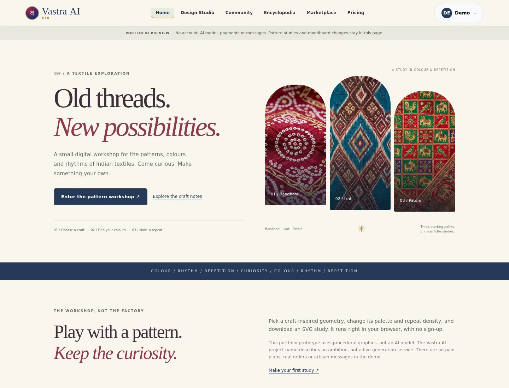
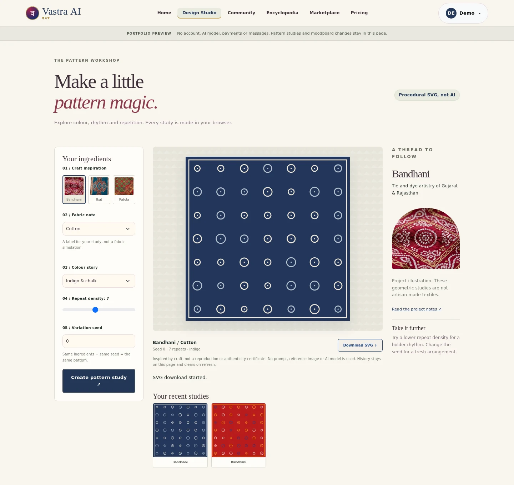

# Vastra AI

### Old threads. New possibilities.

A textile-inspired digital workshop built with React, Bootstrap, Express and MongoDB. Explore colour and repetition, create a seeded geometric study, and download it as SVG.

> **Portfolio prototype, not a live textile business.** The workshop uses procedural graphics, not an AI model. Sample maker profiles, ratings, materials, prices and community posts are fictional. There are no payments, real orders or artisan messages in the hosted preview.

[Open the live portfolio preview](https://vastra-ai-demo.vercel.app/)



## What you can try

- **Pattern workshop:** Bandhani-, Ikat- and Patola-inspired geometry, three colour stories, repeat density, variation seeds and real SVG downloads. A seed of `0` works. The last eight studies stay in page memory.
- **Material explorer:** search, category and availability filters, pagination and empty states. The demo has three sample fabrics; API mode reads the server catalogue.
- **Local moodboard:** likes, bookmarks, comments and new posts. Refresh clears changes. No message leaves the browser.
- **Craft notes:** introductory project material with links for further reading. Illustrations and geometric studies do not certify authenticity or origin.
- **Responsive interface:** cream paper, indigo, textile imagery, keyboard focus, skip navigation, reduced motion and accessible dialogs.



## Run the demo in a minute

Requires **Node.js 22.12+** and npm. No database, login or API key is needed for this mode.

```bash
cd frontend
npm ci
npm run dev:demo
```

Open the local URL printed by Vite, normally `http://localhost:5173`. All preview routes work with hash navigation.

```bash
npm test
npm run build:demo
npm run preview
```

## Demo mode vs API mode

| Area | Hosted demo (`VITE_DEMO_MODE=true`) | API development (`false`) |
| --- | --- | --- |
| Account | Fictional demo explorer, no password form | Register/login/session requests use Express |
| Materials | In-code sample catalogue | `/api/materials`, mapped to the current backend schema |
| Workshop | Local procedural SVG | Local procedural SVG, not the AI endpoints |
| Community | Local in-memory moodboard | Still local; not connected to the backend community module |
| Marketplace | Fictional profile/contact preview | Still a profile preview; no message sent |
| Pricing | Illustrative arithmetic, sample 5% tax | Same example, not a quote or current tax advice |
| Subscription | No checkout or active paid offer | Concept screen, no checkout |

The repository includes a larger backend with design, artisan, community, encyclopedia, pricing, AI, admin and notification modules. Those modules are preserved, but their presence does not mean the frontend is integrated with them or that they are production-ready.

## Run the API-backed development setup

Use a local/disposable MongoDB database. Do not run seed scripts against a database you care about.

```bash
# Repository root
npm ci
cp .env.example .env
# Edit .env: set MONGODB_URI and a unique random JWT_SECRET.
# CLIENT_URL should match the frontend origin, normally http://localhost:5173.
npm run dev
```

In a second terminal:

```bash
cd frontend
npm ci
cp .env.example .env
npm run dev
```

The Vite proxy forwards `/api` to `http://localhost:5000`. To use a separately hosted API, set `VITE_API_BASE_URL` to that API's origin and allow the frontend origin in the server's `CLIENT_URL`.

- Health: `GET /api/health`
- Register: `POST /api/auth/register`
- Login: `POST /api/auth/login`
- Current user: `GET /api/auth/me` with a Bearer token
- Public catalogue: `GET /api/materials?category=cotton&isAvailable=true`
- Material writes: admin-only in the current backend

Registration and login return `{ status, token, data: { user } }`. Public registration accepts `free`, `brand` or `artisan`, never `admin`.

Cloudinary, SMTP, Redis and AI-service settings belong only in server-side environment variables. Some backend routes need these services. The frontend does not supply them. Never put a secret in a `VITE_` variable because those values are bundled into browser code.

## Checks

```bash
# Backend, no database or external service requests
npm test
npm audit

# Frontend
cd frontend
npm test
npm audit
npm run build
npm run build:demo
```

The regression suite covers password-save hashing, public-role restrictions, JWT algorithms, email-transport construction and upload error handling. Frontend tests cover deterministic SVG generation, XML escaping, seed zero, density limits, sample filters and the default-branch auth contract.

Browser checks cover ten routes at 320, 390, 768 and 1440 pixels, actual SVG download, palette/seed changes, catalogue filtering, local post reset and dialog focus/Escape. The demo makes no `/api` requests.

**Limits:** these are focused regression checks, not a full security audit or live end-to-end certification. MongoDB, SMTP delivery, Cloudinary upload, Redis, AI inference and backend business workflows have not been verified against production services. Complete integration tests, data validation, authorization review and service configuration before accepting real user data or money.

## Deploy the static preview

Deploy only the `frontend` directory on a static host such as Vercel:

| Setting | Value |
| --- | --- |
| Framework | Vite |
| Install | `npm ci` |
| Build | `npm run build:demo` |
| Output | `dist` |
| Node | 22.x or newer compatible release |

`frontend/vercel.json` records the demo build and fallback. The hosted preview is a frontend-only deployment. It is not an Express or MongoDB deployment. A Git push alone does not update a manually uploaded deployment.

For a real backend deployment, use a Node host, provision MongoDB and the required services, set strong server secrets, configure CORS, verify HTTPS and test every enabled workflow first. Production startup refuses an empty or obvious placeholder JWT secret and waits for the database before listening.

## Project map

```text
frontend/src/
  pages/          React screens and workshop
  components/     Navigation, forms, dialogs and ornaments
  services/       API adapters and explicitly local preview services
  data/           Original project notes and sample content
  test/           Frontend regression tests
src/
  controllers/    Existing REST business logic
  routes/         Auth, materials, designs and other API modules
  models/         Mongoose schemas
  middleware/     Auth, uploads, security and errors
  services/       Existing backend service integrations
  config/         Database, Cloudinary and service configuration
test/             Backend regression tests
docs/screenshots/ Verified interface captures
```

## Maintenance notes

- This version follows the repository's current default branch, `claude/vastra-ai-backend-p1whew`. The older `main` backend is different and has not been merged or replaced.
- Tracked environment configuration has been replaced with `.env.example`; local secrets and uploads are ignored. Earlier Git history is unchanged. Rotate any real credential ever committed to history.
- Cloudinary is updated to v2. The existing storage adapter has an old v1 peer range; the explicit npm override keeps one v2 client. Its import path is tested, but a real upload still needs service-level testing.
- Nodemon is pinned to `3.1.11` to avoid the currently flagged newer minimatch chain. Revisit the pin when the upstream advisory is resolved.
- Existing PNG artwork is retained; the UI serves smaller WebP copies. Images are project illustrations, not verified photographs of listed makers. No new ownership or commercial license claim is made for the original assets.
- No repository-wide license file is currently provided. Ask the owner before reusing the code or assets commercially.

### Reading

[Indian Culture Portal: textile history](https://www.indianculture.gov.in/textiles-and-fabrics-of-india/history) · [Manufacturing processes](https://www.indianculture.gov.in/textiles-and-fabrics-of-india/manufacturing-process)
